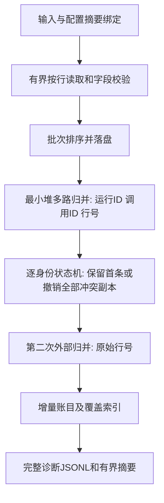

# 外部归并审计：架构、恢复协议与边界

版本0.3.0，2026-10-30。本文为AI辅助技术文档，不替代本人手写申报书。

## 已解决的具体问题

0.2.0逐文件读入、保存解码记录、身份索引及诊断，内存随输入增长。仅把文件按行读入仍不够：远处的冲突副本可能撤销之前统计的身份；一个身份可以重复任意多次；巨量错误本身也可能耗尽诊断内存。

0.3.0新增独立的原生POSIX外部审计引擎。MoonBit实现排序调度、最小堆归并、对账状态机、恢复检查点和审计策略；小型C适配层提供字节流、64位文件偏移、锁、fsync/rename及SHA-256。运行不需要Python、模型服务或GPU。Linux和macOS是目标平台，未实现Windows运行支持。

## 数据路径



每个物理行受字节上限约束；过长行会被读完并拒绝，下一行仍可继续。UTF-8非法行明确报告。批次同时受输入字节量和行数限制；单条记录可超过批次目标，但不得超过单行上限。支持既有规范化、Ollama最终响应封装及明确限定的SDK导出配置。

排序第一关键字是完整运行ID和调用ID，未用短哈希代替身份，因此不存在用哈希碰撞合并不同调用的路径。各有序分片通过最小堆多路归并；最多打开fan_in个输入和一个输出。相同身份的所有记录相邻，状态机只保存首次记录、规范化内容及冲突标记，不保存整个身份组。

冲突诊断相对原始首条记录产生；发现任意不同内容就排除该身份全部副本。输出的有效记录再次按原始行号外部排序，然后由可复用的UsageFold、CoverageIndex处理。第二次排序是保持语义所必需的：安全整数累计溢出会排除某行用量，改变行顺序可能改变保留的部分总量。

完整诊断逐条写入findings.jsonl。摘要只保留代码计数和样本，样本同时受条数与64KiB序列化字节限制；不是简单截断诊断后假装全部通过。清单最多4MiB和100万任务×阶段单元，缺失单元惰性枚举。没有清单时，不能据审计通过判断覆盖完整。

## 检查点与恢复

工作目录必须新建，权限0700；已存在目录不会被当作新任务覆盖。恢复必须显式--resume，保持相同资源配置。工作目录锁排斥同时写入；进程终止后由操作系统释放。

1. 输入采用流式SHA-256指纹，清单文本及资源选项一起绑定到引擎协议版本。
2. 分片先写临时文件、同步、原子改名，再写摘要；最后提交带校验的checkpoint.json。
3. 只有替代文件与检查点已经提交，才删除已消费的输入分片。恢复会处理提交后尚未清理的最后一组输入。
4. 恢复重新核对输入/清单/选项绑定，并在读取中间文件前核对摘要；完成任务的报告与诊断也校验。
5. 摄取在已提交的物理行和64位字节偏移处继续，多路归并在已提交输出组处继续。身份对账及最终审计阶段若中断，从该阶段开头重放，不宣称任意CPU指令级恢复。

故障重放只覆盖工具拥有的固定命名文件，不重写原始日志。无网络或外部工具执行。中间记录剥离未使用的prompt/response正文，运行ID、模型名、任务ID等标识仍可能敏感。

摘要检测内容变化，不认证日志来源；工作目录被有权用户连同摘要一起重写，不属于防篡改证明。测试覆盖进程SIGKILL及检查点暂停，未验证突然断电、硬件故障、网络文件系统或恶意同用户进程修改。不要把fsync及SHA-256说成经过认证的事务数据库或密码模块。

## 复杂度与资源说明

设N为有效记录数，R为初始分片数，B为配置批次，F为归并fan-in。分片排序约O(N log B)，归并每轮约O(N log F)，有序分片轮数约ceil(log_F R)，身份处理流式单遍；有效记录按行号排序还需第二轮外部排序。这里的比较成本还取决于字符串长度。

工作集由批次记录、F个归并头、单行缓冲、清单覆盖状态和有界诊断样本组成，不为全部N条记录建立常驻身份表。`batch_bytes`是工作集目标，**不是硬RSS限制**；运行时分配、字符串、清单及文件缓冲另占内存。磁盘保存中间分片和完整诊断，遇到磁盘不足会报错，未实现磁盘配额或后台清理命令。新引擎用额外I/O、排序和摘要计算换取较低内存，不以更快为承诺。

## 运行和产物

```sh
job_root=$(mktemp -d)
moon run cmd/runledger-large -- examples/clean.jsonl "$job_root/job" --manifest examples/manifest.json
moon run cmd/runledger-large -- examples/clean.jsonl "$job_root/job" --manifest examples/manifest.json --resume
```

需要在有MoonBit工具链的源码目录运行。可指定--batch-bytes、--batch-rows、--fan-in、--max-line-bytes、--sample-limit及--format。修改这些选项需要新工作目录；恢复必须重复原来的选项。

产物包括job.json、带校验的checkpoint.json、report.json、findings.jsonl及按源行号排列的有效记录。报告schema与旧audit不同：完整findings移到JSONL，report包含diagnostic_counts、sample_findings及sample_truncated。退出码0表示检查通过，1表示完整执行但发现问题，2表示配置/完整性/I/O错误。测试用--pause-after-checkpoints可在提交检查点后暂停，返回75。

因单行上限和严格UTF-8策略，新引擎不是对任意旧输入无条件等价的替换；合法配置清单、UTF-8和行长范围内的记录，账目、覆盖结果与诊断内容通过对照检查。SDK状态UNSET仍被拒绝，未新增任意OTLP支持。部分总量、未知用量或诊断存在时，仍不能证明完整账单或准确率。

## 验证入口

```sh
moon test --deny-warn
moon test --target wasm-gc --deny-warn
moon build --deny-warn
python3 scripts/test_external.py
python3 scripts/check_invariants.py
python3 scripts/benchmark_external.py --sizes 100000 1000000 --output reports/external-benchmark-final
```

外部引擎黑盒覆盖跨分片冲突、原始顺序相关溢出、每个可提交检查点的恢复、真实SIGKILL、输入/清单/选项变化、摘要损坏、锁、非法UTF-8、过长行、诊断样本字节界限、多个适配器及25组固定种子的故障组合；与旧内存引擎及独立Python参考核对。性能脚本使用POSIX wait4收集每个子进程峰值RSS，比较同一构建的两种模式；一次观测不当作中位数或生产保证。

SHA-256实现依据[FIPS 180-4](https://csrc.nist.gov/pubs/fips/180-4/upd1/final)，有标准向量和Python hashlib文件摘要交叉检查；不声称FIPS认证。已有工程基础继续使用MoonBit标准库与moonbitlang/x，未移植其他外部排序项目的实现。

最终本机观测与全部原始字段见[外部引擎基准](../benchmarks/external-README.md)：百万条账目一致，峰值RSS约631.19 MiB与5.83 MiB，对应耗时约5.21秒与85.99秒。单次合成观测，不是生产保证。
